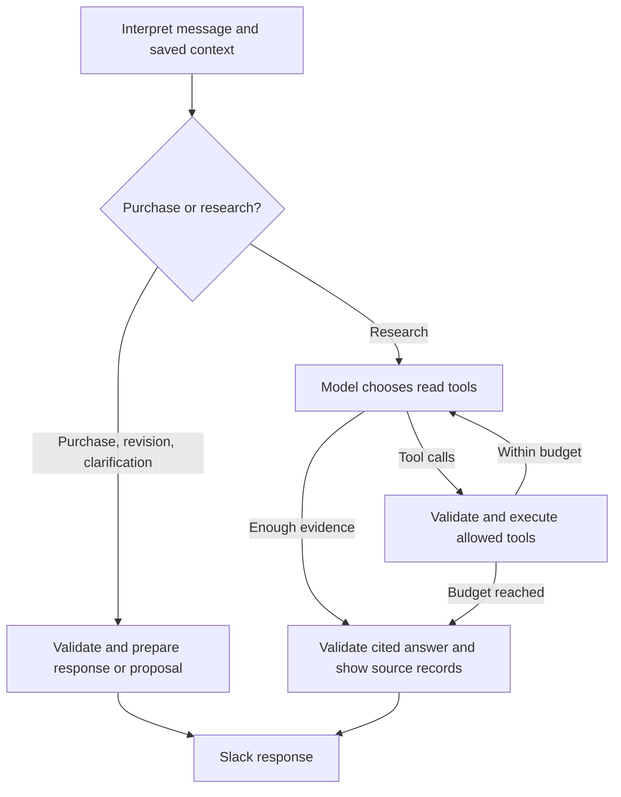

# Procurement assistant demo

A single-user Slack assistant that compares recorded suppliers, collects purchase details,
and writes to ERPNext only after an approval-button click. Approval submits orders within
`ORDER_SUBMIT_LIMIT` (default 5,000); larger orders need a different approver to submit the draft.

## Run

Configure `.env` from `.env.example`, including OpenAI and Slack credentials, the Slack channel,
an approver's Slack user ID, and `APP_TIMEZONE` (default `Europe/Berlin`). With ERPNext seeded:

```sh
make up-app
make init-db
make slack
```

The listener also creates missing application tables on startup. Existing proposals are retained.
Conversation state lives in the new `buyer_conversations` table and survives listener restarts.

## Demo conversation

Use a real item code in your ERP, such as `S-66100` in the Mizan sample.
`ITEM-A` and `Supplier X` below are placeholders, and are also the synthetic test fixture names.

1. Post: **Which suppliers can provide ITEM-A? Compare price and delivery history.**
   The bot lists recorded suppliers, historical prices/dates, and delivery scores. No proposal
   or approval buttons are created.
2. **Reply in the same Slack thread:** **Prepare an order for 20 units from Supplier X,
   needed next Friday.** Use an actual supplier from the comparison. The item comes from
   conversation context. The bot shows an approval card with quantity, date, warehouse and
   estimated line total.
3. Reply: **Make that 30 units.** The card is updated with a new immutable proposal ID.
   Its previous approval ID is invalidated. Supplier, item and delivery date are preserved.
4. Click **Place order** for a purchase within the submission limit. For a larger purchase,
   **Create draft PO** saves a draft and a different approver uses **Submit order**. The bot
   returns the document name and an ERPNext link. **Don't order** rejects the proposal.

Start another thread with **Order some packaging**. The bot asks which item and how many units,
as well as any remaining required details. Answer in that thread to complete the request.
Item codes are matched exactly (case-insensitive); arbitrary product descriptions need clarification.

Normal messages use separate conversations per Slack thread and user. Repeated `/propose`
commands share a conversation per channel/user; replying to a command's bot message starts
a thread with a snapshot of that command's context. Continue in that thread afterward.

Required dates support `today`, `tomorrow`, weekdays, `next Friday`, and `YYYY-MM-DD`.
Weekdays resolve to the coming occurrence; `next Friday` on a Friday means seven days later.
The exact ISO date is shown before approval. Other date phrases trigger clarification.

## Verification

```sh
uv run pytest -p no:capture
uv run mypy src
uv run ruff check src tests scripts/slack_listen.py scripts/eval_demo.py
uv run python scripts/eval_demo.py --live
```

The live rehearsal uses the configured LLM and API credits, synthetic purchase records, a
temporary SQLite vault and a recording writer. **It never connects to Slack or ERPNext.**
It checks the three demo messages, question-only behavior, stale approvals, missing quantities,
and clarification follow-ups. Unit tests also exercise the ERP writer through mocked HTTP.
`-p no:capture` avoids a local Conda/readline crash observed with pytest's capture plugin.

## Boundaries

The model reads the request and, when the buyer asks it to choose, ranks the recorded sellers.
Python checks that the chosen supplier and price are in those records, validates the quantity
and date, and stages the draft. A named supplier is used directly. A shortlist does not create
a purchase until the buyer picks one. The model has no ERP write tool. Approval stays on the button.

Prices are historical estimates, not current quotations. Delivery scores describe recorded
receipt dates across the supplier's history, not current availability or complete delivery.
This demo does not implement general database Q&A, stock planning, or tax calculations.
Monetary conversion and purchase-UOM negotiation are outside this single-company demo's scope.
Confirm commercial terms before approving an order.

## LangGraph workflow

The Slack entry point now invokes `agent/graph.py`, an explicit LangGraph `StateGraph`.
An initial structured intent check distinguishes purchase authorization from research.
It does not choose the research tools: the investigating model chooses a tool, sees its
result, and can choose another tool before completing its answer.



Research tools are `lookup_sellers`, `compare_suppliers`, `search_policy`, `check_invoices`,
and `get_purchase_order`. For example, **Check INV-DEMO against its purchase order and our
invoice-match policy** can trigger several tools in a single request. Substitute a real invoice
identifier when using Slack. Supplier rankings are still chosen by the model and validated
against the records; shortlists remain available for follow-up selections.

Research has a maximum of six tool-selection rounds and ten tool executions per message.
Unknown tools and invalid arguments return errors to the model; it can correct the request
within that budget. Final policy, invoice and order references are checked against retrieved
identifiers, and original source sections/exception figures accompany the answer. These checks
establish source provenance, not a guarantee that every generated inference is correct.

The graph's intermediate messages live for one invocation. Cross-message buyer state and
proposal revisions remain in PostgreSQL through `ApprovalVault`; graph checkpoints are not
enabled. An interrupted investigation restarts on retry. Approval-button handlers continue to
own ERP creation/submission, including the configured submission limit and second-approver rule.
Orders within that limit are submitted by approval; larger orders remain drafts for a different
approver.
